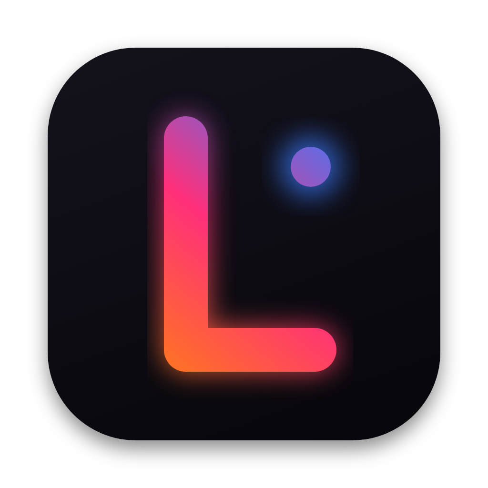
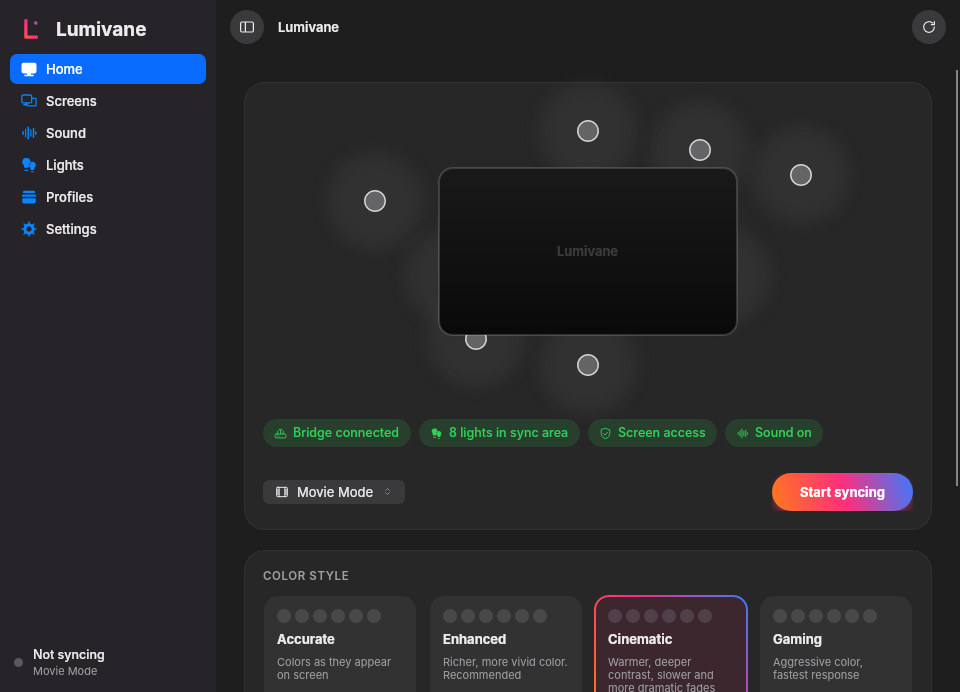

<p align="center"></p>

<h1 align="center">Lumivane</h1>

<p align="center">Philips Hue lights that follow your screen and your sound.<br>Everything is processed on your own computer.</p>

<p align="center"></p>

## Pick your platform

| Platform | What you get | Get it |
|---|---|---|
| **macOS 14+** | Native app: ScreenCaptureKit, Metal, menu bar | [docs/MAC.md](docs/MAC.md) |
| **Windows 10+ and Linux (X11)** | Same app and interface, one shared codebase | [docs/DESKTOP.md](docs/DESKTOP.md) |
| **Amazon Fire TV** | Hue remote with ambient scenes | [docs/FIRETV.md](docs/FIRETV.md) |

Downloads are on the [Releases page](https://github.com/alikhadim/Lumivane/releases). A Hue Bridge on the same network is needed; Demo Mode works without one.

## What it does

- **Screen sync** over the Hue Entertainment API (DTLS 1.2) with a REST fallback
- **Sound sync** from system audio or a single app, with bass, beat and tempo detection
- **Multi-display:** one display, mirror, or extend with a display per light
- **Color styles:** Accurate, Enhanced, Cinematic, Gaming, with a live comparison
- **Profiles** for movies, music, gaming and ambient use
- **Light hub:** switches, dimming, color, rooms, zones, scenes
- **Demo Mode:** virtual bridge, lights and displays, nothing leaves your machine
- **Private:** no account, no telemetry, no analytics, no cloud dependency

## Status

Tested on one setup. The Mac app is the most mature. Windows was run on one machine and Linux was tested against a real X server and PulseAudio. Protected video can capture as black on every platform. Limits and test status per platform are in the docs above and in [docs/RELEASE_REPORT.md](docs/RELEASE_REPORT.md).

## Build

```sh
swift test                      # Mac core tests
scripts/build_app.sh            # Mac app and dmg
scripts/build_desktop.sh        # Windows zip and Linux tarball (needs the .NET 8 SDK)
```

More: [architecture](docs/ARCHITECTURE.md), [color pipeline](docs/COLOR.md), [privacy](docs/PRIVACY.md), [contributing](CONTRIBUTING.md).

Not affiliated with, endorsed by or sponsored by Signify N.V. or Philips. "Philips" and "Hue" are trademarks of their owners and are used here only to state compatibility.

MIT license, see [LICENSE](LICENSE).
